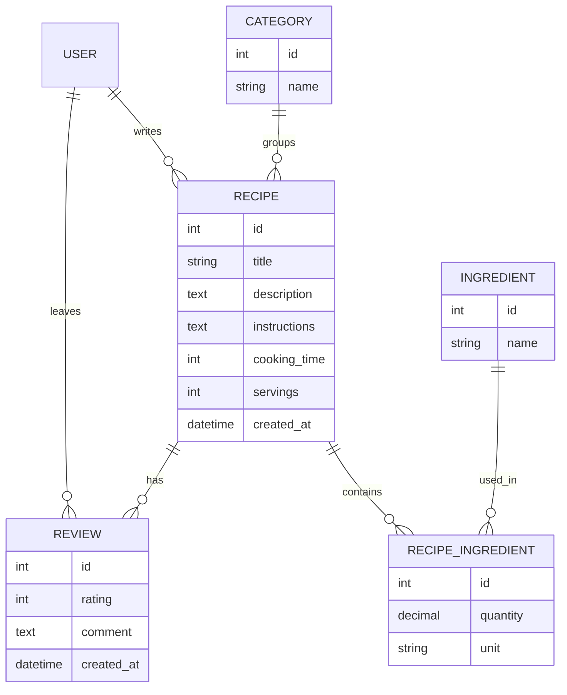

# Recipebook

Рецепттер сайтының backend жүйесі (Django). Пайдаланушылар рецепт қосып,
санат пен ингредиент бойынша іздеп, рейтинг пен пікір қалдырады.

## Функциялар

- Тіркелу және кіру
- Рецепт қосу, өзгерту, өшіру (тек автор)
- Санат бойынша шолу және атау мен ингредиент бойынша іздеу
- Дайындау уақыты бойынша сүзгі
- Рецептке рейтинг пен пікір қалдыру
- Админнің модерациясы

## Модельдер

| Модель | Өрістер |
|---|---|
| Category | name |
| Ingredient | name |
| Recipe | title, description, instructions, cooking_time, servings, created_at, category (FK), author (FK) |
| RecipeIngredient | recipe (FK), ingredient (FK), quantity, unit |
| Review | recipe (FK), user (FK), rating (1-5), comment, created_at |

## ER-диаграмма

## Іске қосу

1. Репозиторийді көшіру:

       git clone https://github.com/Shyngysxan/recipebook.git
       cd recipebook

2. Виртуалды орта жасау және қосу:

       python -m venv .venv
       .venv\Scripts\activate

3. Кітапханаларды орнату:

       pip install -r requirements.txt

4. Базаны дайындау және админ жасау:

       python manage.py migrate
       python manage.py createsuperuser

5. Серверді қосу:

       python manage.py runserver

6. Админ панель: http://127.0.0.1:8000/admin/
## API (№6 жұмыс)

| Әдіс | URL | Сипаттама | Статус |
|---|---|---|---|
| GET | /api/recipes/ | Рецепттер тізімі | 200 |
| POST | /api/recipes/ | Рецепт жасау | 201, 400 |
| GET | /api/recipes/<id>/ | Бір рецепт | 200, 404 |
| PUT | /api/recipes/<id>/ | Рецептті жаңарту | 200, 400, 404 |
| DELETE | /api/recipes/<id>/ | Рецептті өшіру | 200, 404 |

Міндетті өрістер: title, instructions, cooking_time, author_id (тек POST-та).
Қате формат: {"status": "error", "message": "...", "errors": {...}}
