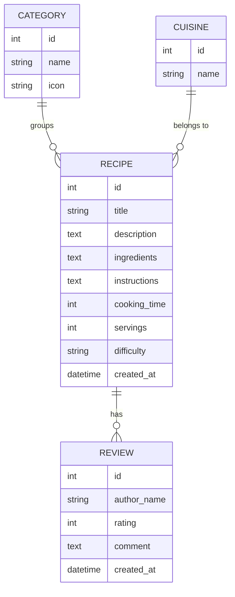

## Модельдер

| Модель | Өрістер |
|---|---|
| Category | name, icon |
| Cuisine | name |
| Recipe | title, description, ingredients, instructions, cooking_time, servings, difficulty, category (FK), cuisine (FK), created_at |
| Review | recipe (FK), author_name, rating (1-5), comment, created_at |

## Іске қосу (деректермен)

    python manage.py migrate
    python manage.py createsuperuser
    python manage.py loaddata sample_data
    python manage.py runserver

Сайт: http://127.0.0.1:8000/ , админ панель: http://127.0.0.1:8000/admin/